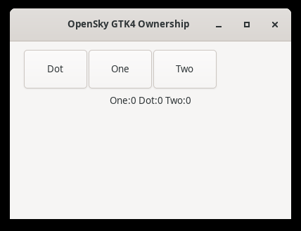
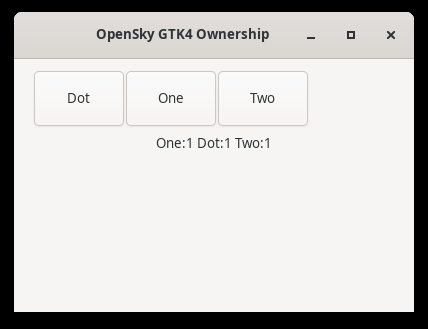

# OpenSky 0.2.40: driver 0.38 qualification

SDK qualified runtime: `ce39bd064bc8b3ed9d078823a298300d64342088`. Driver: `95b620a301c23af9da5f771c7c3f0a448a91590c`. The fork merges canonical driver 0.38.0 (`85e2b1318bd77ccf3cfa88ccdf875a4bb7eaed19`) while preserving contributor history, exact resource ownership, stable Mac signing, source-only installers and uncertain-input safety. [Structured evidence](driver038-qualification88.json).

## Verified behavior

| Contract | Application evidence | Boundary |
| --- | --- | --- |
| Native plaintext paste | Selected ASCII and Unicode replacements save exactly, 29 and 46 UTF-8 bytes. Clipboard contains the payload. A partial handler saves `par` after one dispatch and returns unknown effect. | Bounded grants; missing foreground or clipboard authority refuses before mutation. |
| Stop and completion | At the 500 ms deadline, 47 of 1,000 Unicode characters are visible. The active action completes and all 2,750 UTF-8 bytes save; the following Save starts after completion. Queued cancellation never dispatches. | Completion/drain semantics; Stop does not promise hard cancellation or rollback. Never replay uncertain input automatically. |
| Process replacement | A fresh app lookup binds the replacement; retained handles refuse stale input. One selected paste saves the exact 75-byte replacement. | Original and replacement identities are independently recorded. |
| GTK4 foreground input | Each fresh observed One, Dot and Two button receives exactly one click; independent app counters become 1/1/1. | Driver receipts remain unverifiable; app counters confirm outcomes. Pointer geometry is not established by this test. |
| Relative capture paths | The exact 640×480 PNG is saved and returned; focus, text and clipboard remain unchanged. | One exact owned native window. |
| Mac input | Existing Safari renderer input and tab/window shortcuts pass before and after the upgrade. TYPE-W02 receives all seven trusted `Alpha87` events once and withholds unsafe zero-delivery retry advice. | Three scoped physical Mac checks; issues 19 and 66 remain open. |

The [fresh Bookworm build and separate binary consumer](https://github.com/tanishqkancharla/opensky/actions/runs/39664557670) use Node 22.23.4, ordinary UID1001, TigerVNC/X11, XFWM4 and a shared D-Bus/AT-SPI session. Required packages and bounded grants are recorded in the run and [host integration guide](halo-host-integration.md). No unrestricted grants, Chrome sandbox bypass or VM is used for this acceptance. All 7 native, 3 replacement and 4 GTK4 supervisors exit without force; all 3 owned replacement-test children exit. 724 Linux unit, 275 embedded SDK and 3 TLS checks pass separately from the application assertions.

The [OpenSky three-platform build and unit run](https://github.com/tanishqkancharla/cua/actions/runs/39664360822) passes. The [Valgrind run](https://github.com/tanishqkancharla/cua/actions/runs/39664363792) passes on attempt 2; attempt 1's startup timeout remains recorded, with no confirmed cause or deadline change. This does not mean every inherited monorepo workflow is green. Unavailable/cancelled lanes and unrelated component failures remain visible in the structured evidence.

## Integration and retained safety

Linux observation tokens retain the fork's no-replay guard: an edit already dispatched cannot fall back to a freshly resolved element index after an uncertain response. A regression owner covers both proven and unproven window membership. Shared synthetic DOM click adopts upstream bounded semantic readback only after a successful dispatch receipt, retaining exception, detached-node, native HTML option and missing-receipt refusals. That DOM classification is verified by core tests, not by a new sandboxed Bookworm browser run. Trusted browser input is never silently replaced with synthetic events.

The TypeScript API runtime is unchanged; the release selects the exact new driver and publishes its source-addressed Linux archive. [Installation and checksums](linux-driver-distribution.md), [current native effects](halo-current-native-evidence.json), and [supported host lifecycle API](halo-host-integration.md). Required foreground, display, application/window, clipboard and file grants remain explicit. Driver installation remains an explicit host operation.

## Remaining limits

Sandboxed Chrome in the Bookworm production container, Windows desktop input, Wayland and other architectures remain unqualified. Positive partial counts on self-clearing web fields remain outside the narrow zero-delivery fix. Mac cold launches/documents (#19/#66), full paid-source admission and npm registry authentication remain unresolved. No new paid benchmark arm or parity score is claimed. Install the attached `opensky-cua-0.2.40.tgz`; npm registry publication is separate.
