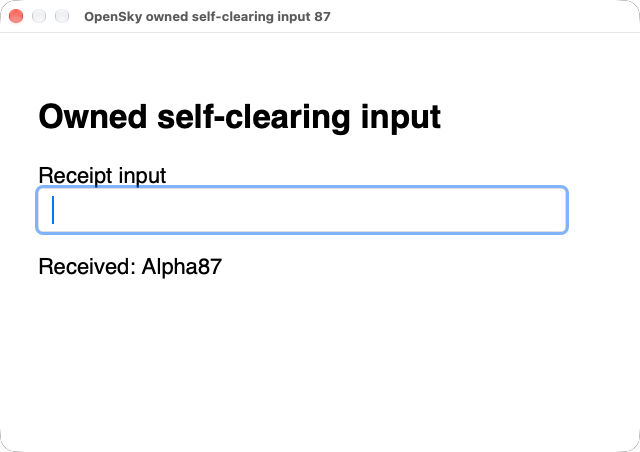

# Web typing safety in OpenSky 0.2.39

Exact driver `4a9dc4da3225f7880c58b45a4be719e837954fe1` (0.37.0) preserves injaneity's upstream3133bbbff fix. An unchanged AX value in a web field cannot prove zero delivery. The old driver consumed all seven trusted characters of `Alpha87` but returned `type_text_incomplete`, `delivered_chars:0`, `retry_from_character:0`, `retryable:true`. The fixed driver reports `effect:unverifiable` and omits those three fields. Observe actual state before further input; no replay or rollback occurs.



Permanent public SDK owner TYPE-W02 independently records trusted WebKit input events and renderer output, verifies one dispatch, and removes its exact child and temporary bundle. Existing Safari CLICK-W01 passes first.711Mac platform units and hosted Mac CPU jobs pass; removing the fix fails the polling owner. The signed com.opensky.driver identity, both grants and actual250/50ms daemon observation settings survive rebuild.

[Fresh Bookworm build and separate consumer](https://github.com/tanishqkancharla/opensky/actions/runs/39628731420) select SDK `bee78bc61161f233387fb51834d5a2a4f1d029de` and the exact driver above: Node22, ordinary UID1001, TigerVNC/X11/XFWM4, shared D-Bus/AT-SPI and bounded grants. 671Linux units,3TLS and 275embedded SDK owners pass. Actual selected ASCII/Unicode paste, uncertain partial delivery,500ms timeout followed by completion/drain and ordered Save, queued cancellation, replacement binding, GTK4 foreground clicks and relative capture pass. No Chrome sandbox bypass. [Structured evidence](web-typing-safety87.json).

Run the regression on an explicitly provisioned Mac with the signed driver already running:

```sh
cd e2e
OPENSKY_REAL_DRIVER=1 OPENSKY_DRIVER_BINARY=/Applications/OpenSkyDriver.app/Contents/MacOS/opensky-driver npm test -- specs/native-web-self-clearing.test.ts
```

The public normalized response may omit optional `verified`; `effect` is the supported outcome. Positive partial counts on self-clearing fields are outside this narrow fix. Mac19/66, sandboxed Bookworm Chrome, Windows GUI, other architectures, full upstream0.38 integration and paid-source admission remain unqualified/unresolved. No benchmark score or paid-agent spending change. SDK compiled output is unchanged; attached tarball and driver-assets metadata select the corrected pin. npm registry authentication remains pending.
