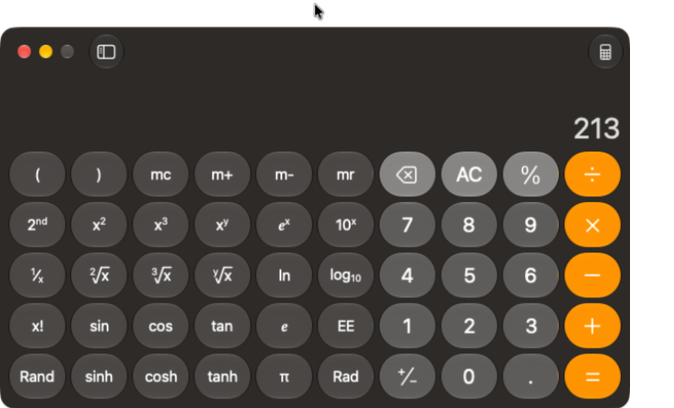
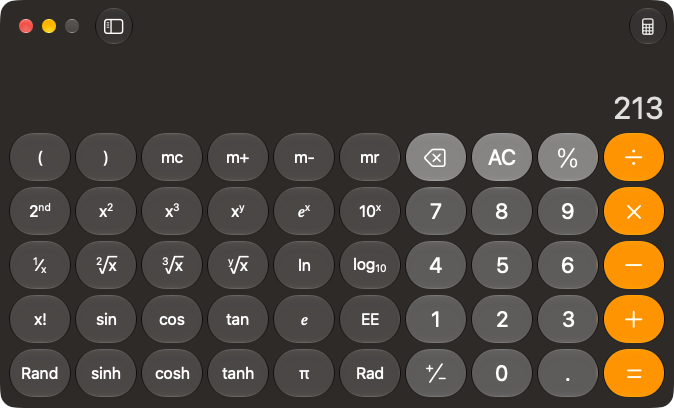

# Mac window captures with the pointer outside the window

Issue [75](https://github.com/tanishqkancharla/opensky/issues/75) reproduces upstream [5476](https://github.com/trycua/cua/issues/5476) through the actual signed Mac driver and public SDK. Backport [757ae8c](https://github.com/trycua/cua/commit/757ae8cedb87f8c8d2441f748aee7236767b18a0), authored by Francesco Bonacci, excludes the hardware pointer from ScreenCaptureKit single-window configurations. Original author/coauthor history is retained in fork `fc1b38e8bd1f5fbbde865c62c4f703c736624775`.

## Public call and actual result

```js
const app = await cua.getApp("Calculator");
const screenshot = await app.getScreenshot({ emit: false });
```

Use the same exact owned Calculator window, moved without resizing, and place the real pointer inside, 24 desktop points above, above again, then inside again. Observe screenshots without keyboard or click input. Restore the original pointer position and close the exact owned app after each source run.

Both sources report valid screenshot geometry, scale 1 and 674×408 output. The old source `034fd65a068f303e863af09ab035b12b94dd27e1` includes the outside pointer, shrinking and offsetting the window inside those dimensions. Both outside images have nontransparent bounds `(0,2,630,408)` and five of six sampled edges become fully transparent. Both inside controls fill the image. Geometry dimensions alone therefore fail to detect the content mismatch.

| Original signed driver, pointer above | Fixed signed driver, pointer above |
| --- | --- |
|  |  |

On the fixed source, all four images retain 674×408 output, fill `(0,0,674,408)` nontransparent bounds and all six edge samples are opaque. These images are original SDK PNG bytes; hashes, sampled coordinates and alpha values are in [the evidence](window-capture75.json). Nothing is reconstructed or resized.

## Regression and scope

Whole Mac crate: 682 passed, six desktop owners ignored. The upstream canonical AppKit pointer-outside owner compiles and is selected by the canonical Mac runner; its recorded desktop execution is not claimed here. All 16 canonical Cargo locks and format pass. Existing actual SDK `CLICK-N01`, `DIFF-N01` and screenshot/window-transition `WINDOW-N01` pass. Exact owned Calculator/Safari exits are verified, original pointer restored, and independent audit preserves the original Calendar PID/window. Stable signing identity and existing Accessibility/Screen Recording permissions are retained; daemon observation settings remain 250/50 ms.

Fresh source-exact [Bookworm archive qualification](https://github.com/tanishqkancharla/opensky/actions/runs/39244867947) is pending. Supported published SDK remains 0.2.32 until distribution is accepted. This does not fix Mac19/66, establish sandboxed Bookworm Chrome compatibility, or earn a new paired-task score. No paid model arms run.
